<p align="center">
  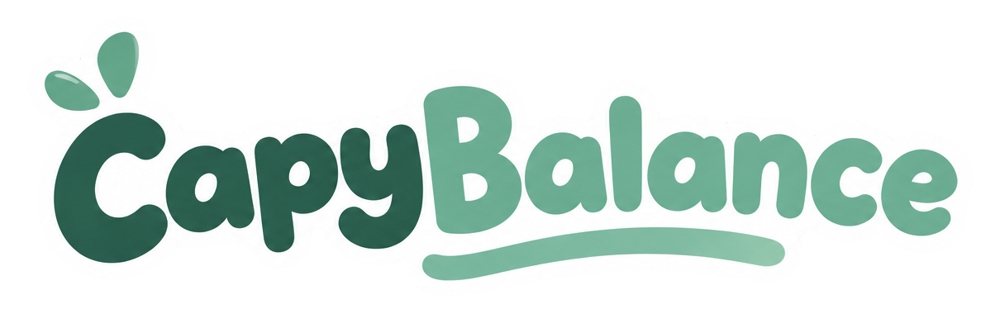
</p>

<p align="center"><b>Save with friends. Nice and steady.</b></p>

CapyBalance is a savings game for people who've never had a budget survive past Tuesday. It works out how much you can safely move to a goal before payday, hands you three small challenges a week that Claude wrote from your own spending, and lets you race your friends without anyone ever seeing a dollar amount. Finish challenges, earn coins, and dress up your pixel capybara.

The more challenges you finish, the better it gets at picking ones you'll actually finish.

```bash
npm install
npm run dev      # emulators + functions + web app → http://localhost:5173
npm run seed     # in a second terminal: 5 demo users, 2 groups, goals, history
```

Sign in as **alex@example.com** / `password`.

<p align="center">
  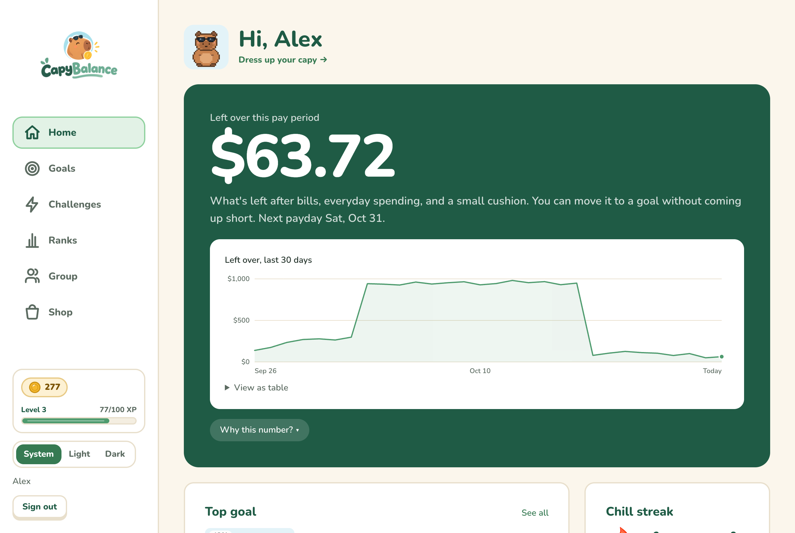
  &nbsp;
  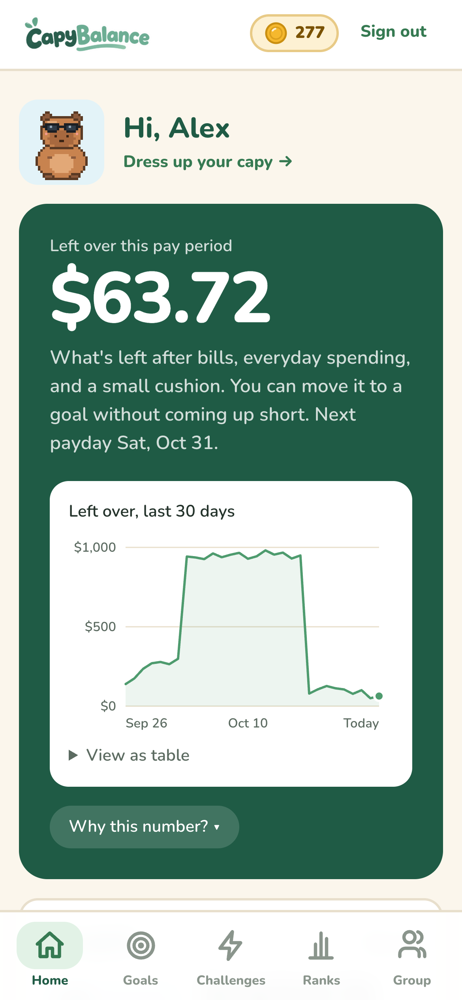
</p>

---

## What's in it

### "How much can I actually save?"

The big green number is what's left after bills due before payday, your usual everyday spending, and a small cushion. It's forecast from your real cash flow (recurring bills are detected, irregular income is handled conservatively), and it comes with a 30-day track record so you can see it's not just made up. **Why this number?** opens the breakdown.

### Goals with a weekly pace

<p align="center">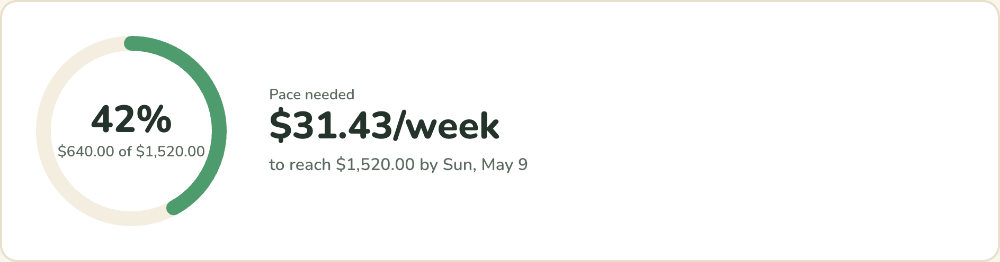</p>

Each goal shows how far along you are and the weekly pace that gets you there by the deadline. Unexpected expense? **Goal flex** puts two plans side by side, pause for a few weeks or save a bit less per week, so life happening doesn't mean failing. **Auto-save** moves a fixed amount or a share of your balance on payday, but never more than what's left over that day.

<p align="center">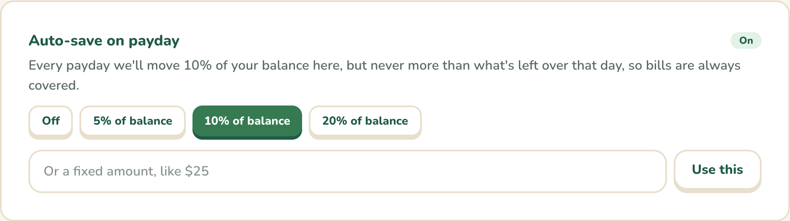</p>

### Challenges Claude wrote for you

<p align="center">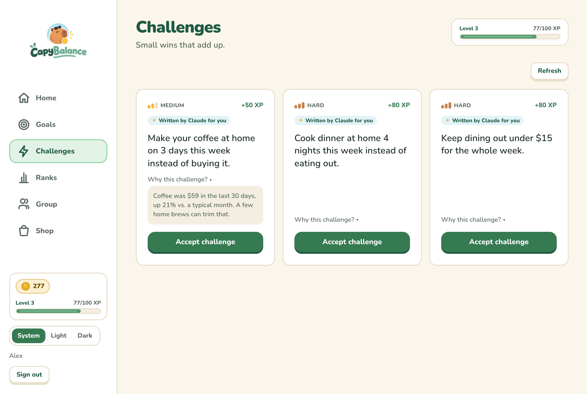</p>

Three a week, easy to hard, each with a "why" that points at your actual numbers ("Coffee was $59 in the last 30 days, up 21%"). Claude only ever sees a summary by category, never a merchant or a transaction. If Claude is rate-limited, slow, or offline, 18 hand-written templates step in and you never see an error. Cards Claude wrote get a small tag; template cards don't.

### Compete without comparing paychecks

<p align="center">
  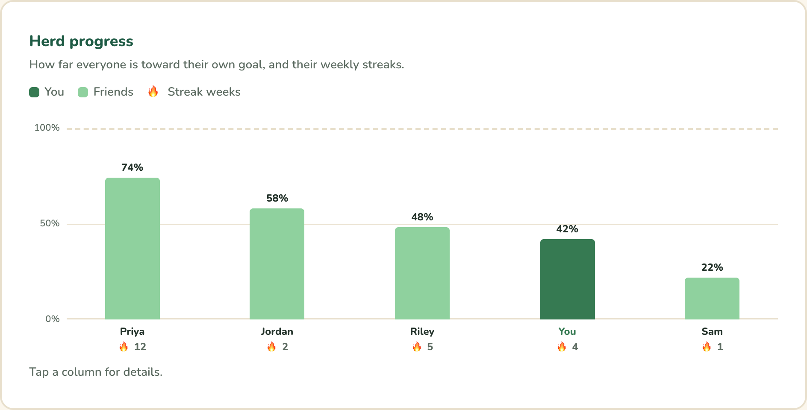
  &nbsp;
  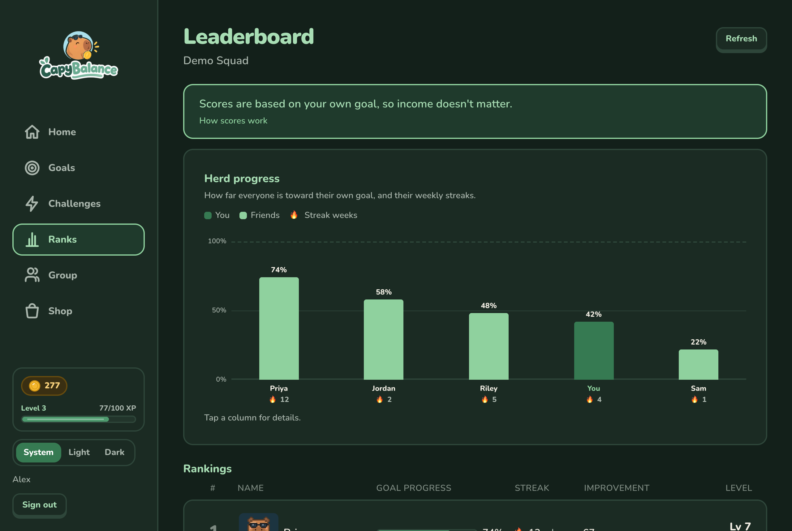
</p>

The leaderboard ranks on **points + spending improvement + 10 × weekly streak**, and progress is a percentage of *your own* goal, so someone saving $20 a week can beat someone saving $200. The group sees progress, streaks and levels. It never sees a dollar amount, and that's enforced by Firestore security rules, not by hiding things in the UI.

**Squad goals** add one shared target per group, with +25 XP for everyone at each milestone. Your squad sees *that* you chipped in, never *how much*.

<p align="center">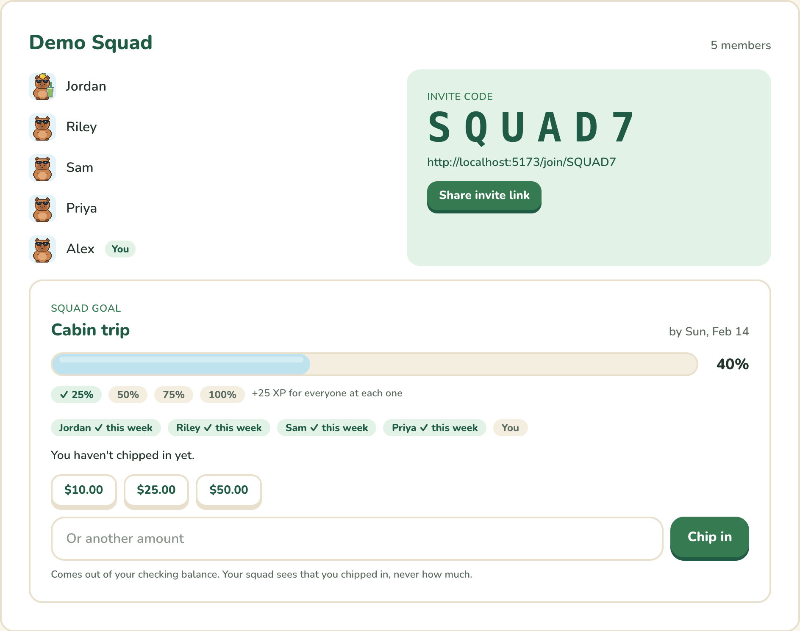</p>

### Coins, levels, and a capybara to dress up

<p align="center">
  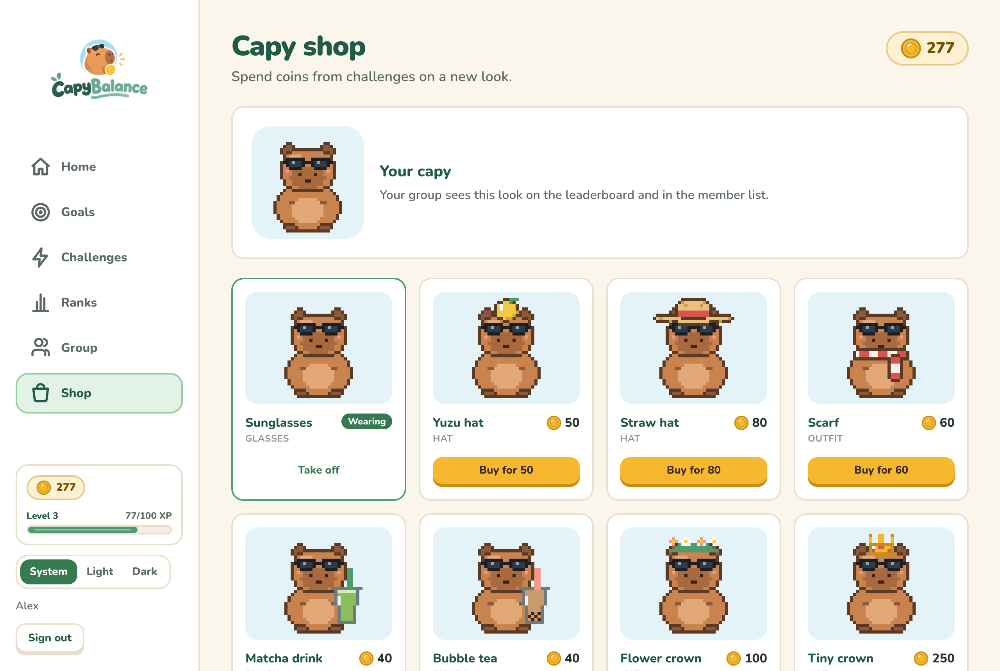
  &nbsp;
  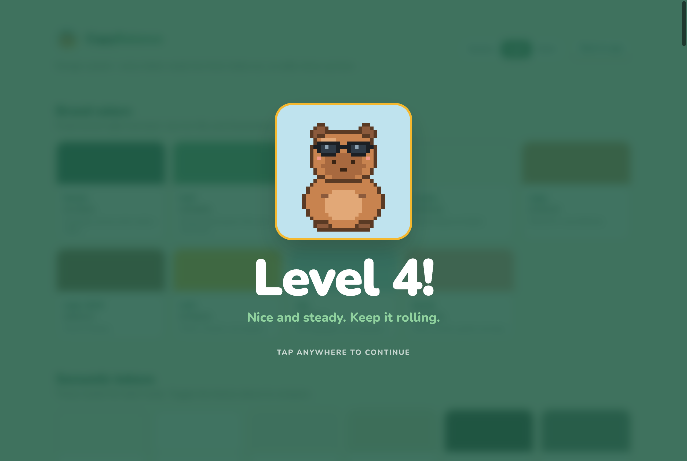
</p>

XP never goes down and drives your level. Coins are earned alongside it and spent in the shop on a yuzu hat, straw hat, scarf, matcha, bubble tea, flower crown or tiny crown. Your capybara shows up on the dashboard, the leaderboard, the member list and the level-up screen, wearing whatever you bought.

---

## How it works

```
 bank transactions (seeded; Plaid later)
          │
  1.  recurring detection        bills, subscriptions, paydays, irregular income
          │
  2.  forecast                   balance − bills before payday − usual spending − cushion
          │                       = "left over"  (+ a 30-day track record)
          │
  3.  spending summary           category totals vs. a typical month. No merchants,
          │                       no essentials (rent, groceries, utilities, insurance, medicine)
          │
  4.  Claude                     writes 6 candidate challenges from the summary and
          │                       from what the bandit has learned you finish
          │
  5.  guardrails                 schema check per item, no investing/debt talk, no
          │                       cutting essentials, points fixed by difficulty
          │                       (any failure → templates)
          │
  6.  Thompson sampling          picks your 3 cards from 18 arms (6 types × 3 difficulties)
          │
  7.  you accept / finish / ignore   → bandit stats, XP, coins, badges, streak
          │
  8.  scores/{uid}               progress %, streak, improvement, level, avatar.
                                  No dollars. The only thing your group can read.
```

Everything is Firebase: Auth, Firestore, Cloud Functions (2nd gen, TypeScript), Hosting. Local development always runs on the Emulator Suite, so nothing touches a real project.

## The interesting part

### The bandit has to learn fast from almost nothing

There are 18 options (6 challenge types × 3 difficulties) and a user sees 3 cards a week. Learning each option separately takes most of a year. So each option's starting guess borrows from your record on the **same type** and the **same difficulty**: if you finish easy cook-at-home challenges, you'll probably finish medium ones too. That shared prior is worth `PRIOR_STRENGTH` virtual attempts, and each option's own results add on top.

We simulated 20 independent worlds of 100 users each for 52 weeks, 3 cards a week like the app, all policies facing the same dice, with 95% confidence intervals across worlds (`npm run simulate`):

<p align="center">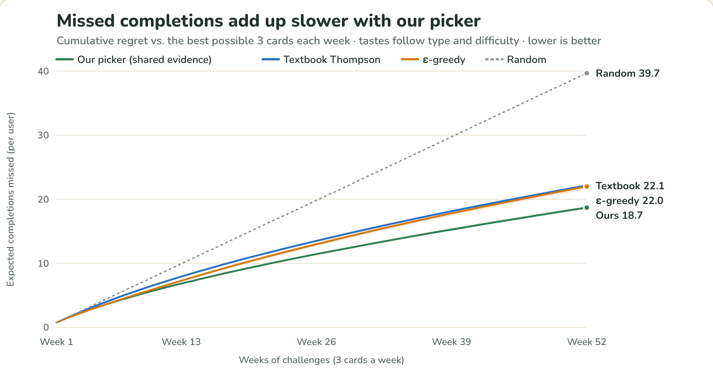</p>

| | Missed completions after a year | Cards finished, last 12 weeks |
|---|---|---|
| **Our picker (shared evidence)** | **18.7** | **55%** |
| Textbook Thompson sampling | 22.1 | 54% |
| ε-greedy | 22.0 | 53% |
| Random | 39.7 | 38% |
| Best possible | 0 | 64% |

**16% fewer missed challenges** than textbook Thompson sampling, and it costs nothing when the assumption is wrong: in a world where tastes don't follow type or difficulty at all, it's still 3.5% better. The completion rates catch up by the end of the year. The win is how fast it learns.

<p align="center">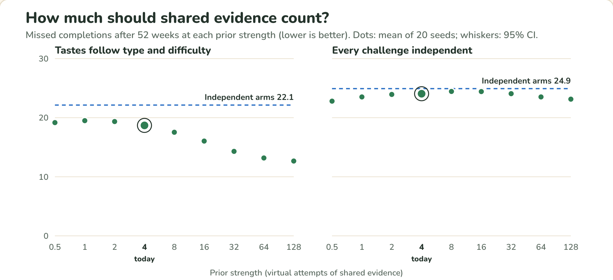</p>

The sweep is the honest bit: sharing kept helping all the way to 128 virtual attempts, the largest we tried, so pooling by type and difficulty matters more than per-challenge history at 3 cards a week. Our simulated users have very little "loves easy cooking, hates hard cooking" in them, though, so a huge prior is partly flattered by the simulation. Production uses 4.

### Is Claude actually better than templates?

`npm run eval:challenges -- --judge` runs both on the 5 seeded personas with exactly the inputs production uses, then has Claude grade every challenge blind (shuffled together, labeled by number):

| | Templates | Claude |
|---|---|---|
| Passes the safety guardrails | 100% | **100%** |
| Reason cites a real number from the summary | 33% | **100%** |
| Reason cites a number that isn't there | 0% | **0%** |
| Mentions the user's own spending categories | 57% | **70%** |
| Wording shared between different users (↓) | 86% | **41%** |
| Judge: specific / doable / coach voice (1–5) | 2.5 / **4.3** / 3.5 | **4.4** / 3.9 / **4.5** |

Templates win on "doable": Claude's challenges are more ambitious. It's 30 challenges from one run per persona; add `--runs 3` for a sturdier sample.

Both sets of results, with downloadable charts for slides, live at **http://localhost:5173/deck/bandit**.

<p align="center">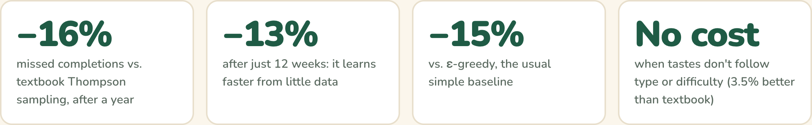</p>

### Privacy is in the rules, not the UI

- `transactions` and `recurring` are server-only. Clients can't read them at all.
- Group members can read exactly one collection about each other, `scores`, and it never contains a dollar amount.
- Security rules can't search groups, so the server keeps `scoreViewers/{uid}` (everyone who shares a group with you) in sync, and the rules check that list.
- Coins, inventory and challenge status only change through callables. Writing them from the client is rejected.
- Claude sees category totals only. API keys live in Cloud Functions secrets, never in the web app.

---

## Commands

| command | does |
|---|---|
| `npm run dev` | the whole product: emulators (Auth, Firestore, Functions), functions watcher, web app on :5173 |
| `npm run seed` | demo data. Run it after every `dev` start: emulator data doesn't survive a restart |
| `npm run dev:mock` | same UI on fake in-browser data. Nothing saves and Claude isn't called. For UI work |
| `npm run payday -- demo-hero` | pretend a paycheck landed today for that persona and run their auto-saves |
| `npm run simulate` | the bandit simulation (~2.5 min) → `scripts/out/banditSimulation.json` |
| `npm run eval:challenges -- --judge` | Claude vs. templates (~10 Claude calls) → `scripts/out/challengeEval.json` |
| `npm test` | unit tests, web and functions |
| `npm run test:rules` | Firestore security-rules tests (starts its own emulator) |
| `npm run build` | production build |

**Demo logins** (password `password`): `alex@` (the demo hero), `jordan@`, `riley@`, `sam@`, `priya@example.com`. Groups: **Demo Squad** (code `SQUAD7`) and **Side Hustle Crew** (`HUSTLE`).

**Pages that aren't in the nav:** `/deck/bandit` (results for slides) and `/styleguide` (the design system and every avatar item).

In mock mode the browser console has `mock.persona("steady-saver")`, `mock.simulateJoin("delivery-spender")`, `mock.errors(1)` and `mock.reset()`.

## Setup

Node 24, and the Firebase CLI (`npm i -g firebase-tools`). Java is needed for the Firestore emulator.

For Claude, put your key in **`functions/.secret.local`** (gitignored):

```
ANTHROPIC_API_KEY=sk-ant-...
```

The model is set by `CLAUDE_MODEL` in `functions/.env`. Without a key everything still works; challenges just come from templates.

**Don't put the key in `functions/.env`.** That file is committed on purpose (it only holds non-secret config), so a key there gets pushed. Firebase also refuses a secret and a plain value with the same name.

## What's where

```
web/                     React + TypeScript + Vite + Tailwind
  src/api/               the only code that talks to the backend: realApi, mockApi, one interface
  src/pages/             one file per screen (Dashboard, GoalDetail, Challenges, Leaderboard, Shop, …)
  src/game/              XP, coins, levels, badges, the level-up celebration
  src/avatar/            the pixel capybara: items.ts is all the art, as data
  src/deck/              the slide charts (no chart library)
functions/src/
  contract.ts            shared types and small helpers, imported by both sides. Imports nothing
  logic/                 pure, tested: forecast, recurring, scoring, bandit, squad, autoSave
  llm.ts                 the only file that talks to Claude
  challenges.ts          getChallenges: summary → Claude → guardrails → bandit → save
scripts/                 seed data, the bandit simulation, the Claude evaluation, payday helper
firestore.rules          who can read and write what
CLAUDE.md                the project rules (privacy, product voice, data model)
```

## Making it yours

### A new shop item (~5 minutes)

1. Add the id to `ItemId` and a `{ name, slot, price }` entry to `SHOP_ITEMS` in `functions/src/contract.ts`. Prices live there so the server decides what things cost.
2. Draw it in `web/src/avatar/items.ts`: a small pixel map placed at `(x, y)` on the 32×32 grid, where `.` is transparent and every other character is a `PALETTE` key.
3. `npm test`. A test checks every item has art, fits the grid and only uses colors that exist.

Slots draw in the order `outfit → glasses → hat → held`, so a drink always sits in front of a scarf.

<p align="center">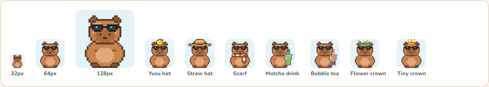</p>

### A new challenge type

Add it to `CHALLENGE_TYPES` in `contract.ts`, describe it in `CHALLENGE_SYSTEM_PROMPT` in `llm.ts`, and give it three template descriptions (easy, medium, hard) in `templates.ts`. The bandit picks up the new arms automatically, and the tests make sure every type has a template at every difficulty.

## Gotchas

- **Re-seed before you demo.** The seed is set up so Alex's first easy challenge levels them up and passes Riley on the leaderboard. That only happens once.
- **A new user's first Claude call takes about 8 seconds.** After that the cards are saved. Open the Challenges page once before presenting.
- **No Wi-Fi, no Claude.** The app quietly falls back to templates and the "Written by Claude" tag disappears. That's the design, not a bug.
- **`npm run dev:mock` is not the product.** Use it for UI work, not the demo.

---

Built at HACK2026. We gonna win.
